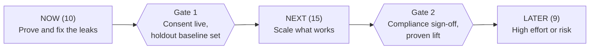
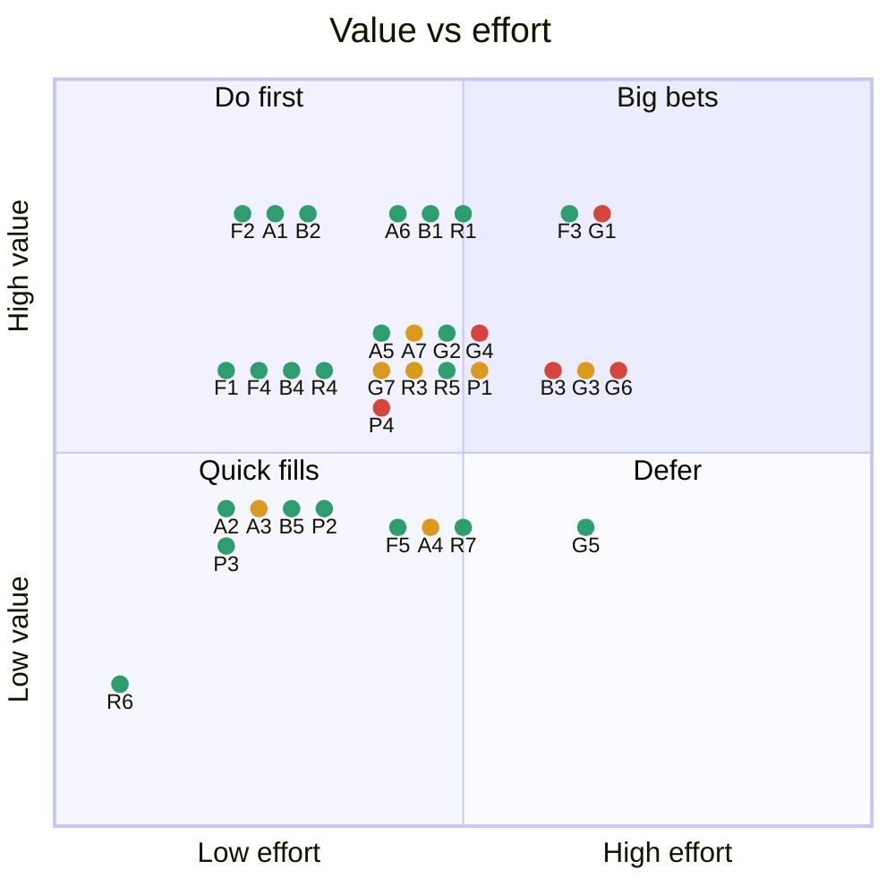

# Marketing use cases for financial services, ranked and sequenced

https://htmlpreview.github.io/?https://github.com/Debashish-Patra/AI-Use-Cases-for-Financial-Services/blob/main/Index.html

Every use case is scored on value, effort and risk, then placed on a roadmap. Foundations come first, and high-risk cases wait behind gates.

**34 use cases** · **10 start now** · **15 next** · **9 wait for gates** · **5 high risk**

Risk key: 🟢 low · 🟡 medium · 🔴 high

## 1. Roadmap

| Stage | Now | Next | Later |
|---|---|---|---|
| **Foundation** | 🟢 **F1** Consent and contact governance 🟢 **F2** Incrementality and holdouts 🟢 **F3** Unified customer record 🟢 **F4** Approved content library | 🟢 **F5** Model fairness and drift checks | · |
| **Acquire** | 🟢 **A1** Lead scoring and speed-to-lead | 🟢 **A2** First-party lookalike audiences 🟡 **A3** Automated creative production 🟢 **A5** Referral and partner engine 🟢 **A6** Partner and agent copilot 🟡 **A7** Conversational lead qualification | 🟡 **A4** Dynamic ad personalization |
| **Activate** | 🟢 **B1** Onboarding failure prevention 🟢 **B2** Drop-off recovery (WhatsApp, in-app) 🟢 **B4** First-transaction guidance | 🟢 **B5** Personalized onboarding checklist | 🔴 **B3** Voice-agent drop-off recovery |
| **Grow** | · | 🟢 **G2** Goal and recurring-investment habit engine 🟡 **G7** RM review-prep copilot | 🔴 **G1** Next-best-product (suitability-gated) 🟡 **G3** Life-event cross-sell 🔴 **G4** Leverage and derivatives upsell 🟢 **G5** Personalized app home 🔴 **G6** Offer and pricing optimization |
| **Retain** | 🟢 **R4** Voice-of-customer mining 🟢 **R6** Send-time and channel choice | 🟢 **R1** Retention engine (churn and win-back) 🟡 **R3** Service-led retention 🟢 **R5** Reputation and complaint triage | 🟢 **R7** Loyalty and rewards personalization |
| **Protect** | · | 🟡 **P1** Behavioral risk alerts 🟢 **P2** Education and safety nudges 🟢 **P3** Scam and fraud-awareness messages | 🔴 **P4** Early repayment-risk outreach |

Phases have no dates. Each gate depends on results and compliance sign-off.

## 2. Value versus effort

Point colour shows risk: green low, amber medium, red high. IDs match the tables below.

## 3. Priority ranking

Priority score = 2 × value − effort − risk. Each is rated 1 to 5 (5 = most value, most effort, most risk).

| # | Use case | Score | Phase | Risk |
|---|---|---|---|---|
| 1 | **F2** Incrementality and holdouts | ███████ 7 | Now | 🟢 |
| 2 | **A1** Lead scoring and speed-to-lead | ██████ 6 | Now | 🟢 |
| 3 | **B2** Drop-off recovery (WhatsApp, in-app) | ██████ 6 | Now | 🟢 |
| 4 | **A6** Partner and agent copilot | █████ 5 | Next | 🟢 |
| 5 | **B1** Onboarding failure prevention | █████ 5 | Now | 🟢 |
| 6 | **R1** Retention engine (churn and win-back) | █████ 5 | Next | 🟢 |
| 7 | **F1** Consent and contact governance | █████ 5 | Now | 🟢 |
| 8 | **F4** Approved content library | █████ 5 | Now | 🟢 |
| 9 | **R4** Voice-of-customer mining | █████ 5 | Now | 🟢 |
| 10 | **F3** Unified customer record | ████ 4 | Now | 🟢 |
| 11 | **B4** First-transaction guidance | ████ 4 | Now | 🟢 |
| 12 | **A5** Referral and partner engine | ███ 3 | Next | 🟢 |

All 34 use cases with detail

| # | ID | Use case | Stage | V | E | R | Score | Phase | What it does | Build with | Sectors |
|---|---|---|---|---|---|---|---|---|---|---|---|
| 1 | F2 | Incrementality and holdouts | Foundation | 5 | 2 | 🟢 1 | 7 | Now | Always-on control groups prove which use cases really add revenue. | Random holdout in the journey tool, weekly lift report. | All |
| 2 | A1 | Lead scoring and speed-to-lead | Acquire | 5 | 2 | 🟢 2 | 6 | Now | Score intent and route each lead to the right RM or partner within a set time. | Lead data plus CRM routing rules; start rule-based, add a model later. | All |
| 3 | B2 | Drop-off recovery (WhatsApp, in-app) | Activate | 5 | 2 | 🟢 2 | 6 | Now | Help arrives when a high-intent user abandons KYC or funding. | Event triggers plus approved message templates. | All |
| 4 | A6 | Partner and agent copilot | Acquire | 5 | 3 | 🟢 2 | 5 | Next | Daily call lists, at-risk clients and health scores for franchisees, agents and DSAs. | Partner dashboard on top of lead and client data. | Broking, Insurance, Banking, Lending |
| 5 | B1 | Onboarding failure prevention | Activate | 5 | 3 | 🟢 2 | 5 | Now | Predict which applications will fail KYC or verification and fix them before submit. | Past rejection data, field-level validation, targeted prompts. | All |
| 6 | R1 | Retention engine (churn and win-back) | Retain | 5 | 3 | 🟢 2 | 5 | Next | Spot customers going quiet and reach those the nudge will actually change. | Dormancy rules first, then uplift model, tested against holdouts. | All |
| 7 | F1 | Consent and contact governance | Foundation | 4 | 2 | 🟢 1 | 5 | Now | Consent, do-not-disturb and frequency caps checked before every message. | Consent store plus a rules check in front of every channel. | All |
| 8 | F4 | Approved content library | Foundation | 4 | 2 | 🟢 1 | 5 | Now | Pre-cleared claims, disclaimers and templates that AI drafts from. | Compliance-tagged library; AI may only use approved blocks. | All |
| 9 | R4 | Voice-of-customer mining | Retain | 4 | 2 | 🟢 1 | 5 | Now | Find themes in calls, chats, reviews and social posts and feed the product backlog. | LLM tagging of transcripts and reviews, monthly themes report. | All |
| 10 | F3 | Unified customer record | Foundation | 5 | 4 | 🟢 2 | 4 | Now | One customer ID across app, branch, partner and call centre. | Identity matching plus an event stream into one customer table. | All |
| 11 | B4 | First-transaction guidance | Activate | 4 | 2 | 🟢 2 | 4 | Now | Walk new customers to a first trade, deposit, loan draw or policy payment. | Journey with 3 to 4 timed messages and in-app tips. | All |
| 12 | A5 | Referral and partner engine | Acquire | 4 | 3 | 🟢 2 | 3 | Next | Score likely referrers and tune incentives. | Referral tracking plus propensity score and incentive rules. | All |
| 13 | G2 | Goal and recurring-investment habit engine | Grow | 4 | 3 | 🟢 2 | 3 | Next | Start SIPs or auto-pay, step up amounts, recover missed payments. | Goal prompts, auto-pay journeys, missed-payment triggers. | Broking, Wealth & AMC, Banking, Insurance |
| 14 | R5 | Reputation and complaint triage | Retain | 4 | 3 | 🟢 2 | 3 | Next | Social listening, sentiment tagging, tickets routed by SLA. | Listening feed, classifier, retrieval for replies, CRM ticketing. | All |
| 15 | B5 | Personalized onboarding checklist | Activate | 3 | 2 | 🟢 1 | 3 | Next | In-app checklist that adapts to where the customer is. | Front-end change driven by onboarding events. | All |
| 16 | P3 | Scam and fraud-awareness messages | Protect | 3 | 2 | 🟢 1 | 3 | Next | Warn customers about phishing and impersonation. | Approved templates, trigger on known scam waves. | All |
| 17 | G1 | Next-best-product (suitability-gated) | Grow | 5 | 4 | 🔴 4 | 2 | Later | Recommend the next product only if it suits the customer’s risk profile. | Product propensity plus suitability rules; compliance sign-off. | All |
| 18 | A7 | Conversational lead qualification | Acquire | 4 | 3 | 🟡 3 | 2 | Next | A WhatsApp assistant asks, scores and books a call. | WhatsApp Business API, approved flows, human handoff. | All |
| 19 | G7 | RM review-prep copilot | Grow | 4 | 3 | 🟡 3 | 2 | Next | A brief ready before each client meeting. | Customer record summary plus approved talking points. | Wealth & AMC, Banking, Broking, Insurance |
| 20 | R3 | Service-led retention | Retain | 4 | 3 | 🟡 3 | 2 | Next | A GenAI support assistant that cuts resolution time. | Retrieval over approved help content, handoff to agents. | All |
| 21 | P1 | Behavioral risk alerts | Protect | 4 | 3 | 🟡 3 | 2 | Next | Circuit-breaker alerts for loss streaks and heavy leverage. | Real-time trade events, alert rules, advisor call task. | Broking |
| 22 | F5 | Model fairness and drift checks | Foundation | 3 | 3 | 🟢 1 | 2 | Next | Regular checks that scores stay accurate and fair across customer groups. | Monitoring job on every scoring model, reviewed monthly. | All |
| 23 | A2 | First-party lookalike audiences | Acquire | 3 | 2 | 🟢 2 | 2 | Next | Find more people like your best customers in ad platforms. | Consented, hashed customer lists sent to ad platforms. | All |
| 24 | P2 | Education and safety nudges | Protect | 3 | 2 | 🟢 2 | 2 | Next | Short educational messages at the right moment. | Approved content plus event triggers. | All |
| 25 | R6 | Send-time and channel choice | Retain | 2 | 1 | 🟢 1 | 2 | Now | Send when each person is most likely to open. | Built-in feature of most messaging tools. | All |
| 26 | G3 | Life-event cross-sell | Grow | 4 | 4 | 🟡 3 | 1 | Later | Salary change, new home or new baby triggers a relevant offer. | Transaction signals plus a life-event classifier. | Banking, Insurance, Lending, Wealth & AMC |
| 27 | P4 | Early repayment-risk outreach | Protect | 4 | 3 | 🔴 4 | 1 | Later | Reach out before a customer misses a payment. | Repayment-risk score; collections and compliance review. | Lending, Banking |
| 28 | R7 | Loyalty and rewards personalization | Retain | 3 | 3 | 🟢 2 | 1 | Later | Rewards matched to what each customer values. | Rewards catalogue plus spend and preference data. | Banking, Payments, Insurance |
| 29 | A3 | Automated creative production | Acquire | 3 | 2 | 🟡 3 | 1 | Next | Resize one master asset, make cohort variants, localize. | Gen-AI tools fed from the approved content library; compliance review before serving. | All |
| 30 | B3 | Voice-agent drop-off recovery | Activate | 4 | 4 | 🔴 4 | 0 | Later | An AI call to high-value drop-offs that also tags the reason. | Voice agent, consent and call-time rules, pilot in a few languages. | All |
| 31 | G6 | Offer and pricing optimization | Grow | 4 | 4 | 🔴 4 | 0 | Later | Per-customer fee waivers or rate offers. | Pricing tests with finance and compliance approval. | All |
| 32 | G4 | Leverage and derivatives upsell | Grow | 4 | 3 | 🔴 5 | 0 | Later | Offer leveraged products to customers likely to want them. | Only after suitability checks; the risk engine can always override. | Broking |
| 33 | G5 | Personalized app home | Grow | 3 | 4 | 🟢 2 | 0 | Later | App layout adapts to the customer’s persona. | Product work: persona model plus a flexible home screen. | All |
| 34 | A4 | Dynamic ad personalization | Acquire | 3 | 3 | 🟡 3 | 0 | Later | Ad variant chosen per segment or intent in flight. | Needs creative variants, audience data and fast testing. | All |

## How to read this

- Scores are judgement calls to re-score with your own data.
- Phases follow the score and dependencies: foundations first, then high-value low-effort cases, then anything high in effort or risk.
- Sectors covered: Broking, Banking, Lending, Insurance, Wealth & AMC, Payments.
- Use cases marked "All" apply to every sector.
